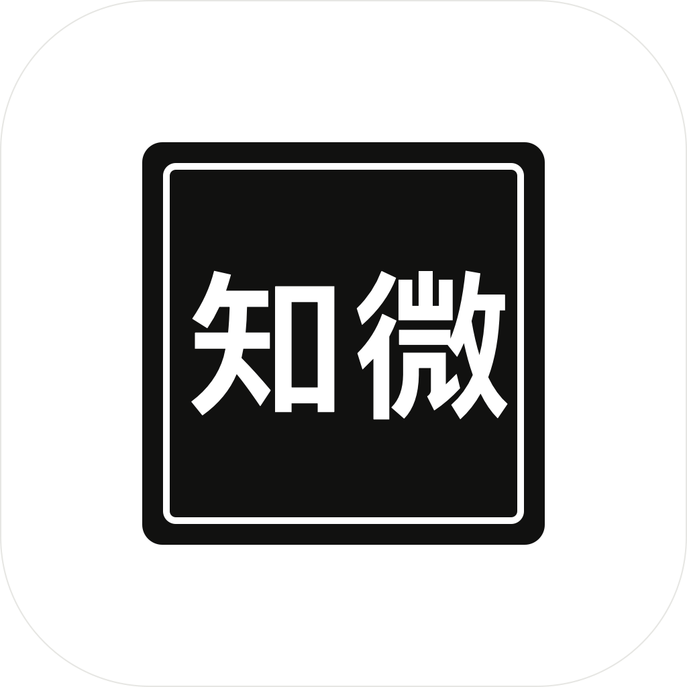

<div align="center">
  
</div>

# 知微 Zhiwei — 用群聊的方式，指挥你的 Agent 团队

[简体中文](README.zh-CN.md) | [English](README.md)

官网，以及一段真跑出来的两分钟实录：<https://siguadht.github.io/zhiwei/>

知微是一个**办公 Agent，不是聊天 Agent**。你把材料丢进去、说一句话，交回来的是一个真的
`.pptx` / `.docx` / `.xlsx`——在 Office 里能选中、能改字的中文正文，不是糊一张图。而且它不会把手上
第一版直接给你：测试岗会按写死的验收规格先检一遍，不合格就打回，所以团队是自己返工的，不用你盯着挑毛病。

团队本身待在你已经熟悉的聊天界面里——一个项目一个专属群，每个 Agent 是一名成员，各有自己的身份、记忆和模型。

---

## 组建你的 Agent 团队

把不同的 Agent 拉进同一个群聊，共同为一个项目服务。团队按项目组织，每个项目都有自己的专属群。

## 定制你的团队成员

每个 Agent 都是独立的实例——身份与记忆独立，可根据需求自由选配大模型服务。给不同的成员换上不同的「大脑」，让擅长的事交给擅长的成员。

## 一句话派活，团队自动干活

你不需要学习怎么写提示词、怎么拆任务。项目经理（Coordinator）会自动把任务拆成小任务，分派给合适的员工（Worker）执行，并把结果汇总给你。需要你决定的事，会弹卡问你，你点一下就行。

## 还有这些

- **记忆与知识库**：友好的聊天记录、收藏、知识库功能，可跨群聊转发消息、项目内经验共享。
- **安全边界**：Agent 们只能在各自所属的项目目录内活动，碰不到你电脑上其他任何文件。

---

## 关于本分支

**知微是开源骨架 [Knowe](https://github.com/HirezmingD/Knowe-agent-groupchat)（MIT）的一条分支。**
上游已经把难的部分解决了，那些代码留着、著作权也归上游：Agent 循环、项目群聊、项目经理拆单、
权限与审批闸门、记忆、上下文压缩、技能加载、MCP 挂载。

这条分支加的是让它从"聊天 Agent"变成"办公 Agent"的那部分：

1. **它交回来的是一个真文件。** 丢材料 + 说一句话 → 拿到能在 Office 里选中改字的
   `.pptx` / `.docx` / `.xlsx`，全中文，不是糊一张图。成员在沙箱里自装生成库，
   产出一个交付物不依赖任何外部 Office 二进制。
2. **一套写死的"什么算合格"。** 7 份内置 SKILL.md：3 份写作规格（各文件类型的结构与排版硬指标）、
   3 份质检规格（**每份内置 15 条可运行断言**）、1 份项目经理必须走的验收纪律。
3. **一个真会打回的质检环节。** 骨架把"交付审阅"这一环整个删过——界面上的"接受 / 拒绝"背后没有实现。
   这条分支把它补回来：交付 → 派质检单给测试岗 → 沙箱里跑 15 条断言 → 不合格就下发返工单。
   全程没改状态机。
4. **审批卡不再背刺。** 原来 5 分钟静默过期，现在会等你。
5. **本地账户与密钥收口。** 真登录页（PBKDF2，只存哈希），并堵掉一处 `GET /settings` 把 API Key
   明文吐给渲染进程的泄露。密钥本体现在只从 `.env` 进来：内存里用，`settings.json` 落的是空串，
   对外接口只报 `has_api_key`。
6. **台账 / 版本 / 看板，数字全是真的。** 也明确没有：不接支付、不做服务端账号、不造字段
   （台账里没有"客户签收"这一列，因为那条路径没有实现）。
7. **整套前端重做**：白 + 黑、零渐变零阴影、一屏一处强调、尺寸按真实产品量；外加成员自主命名的三档规则。

上面第 2 条那 7 份菜谱就在仓库里：`skills/system/`，随代码一起版本管理，`npm run dist:mac` /
`dist:win` 会把它拷进安装包（`resources/skills`），主进程打包态用 `KNOWE_SYSTEM_SKILLS_DIRS`
指过去。后端按 `KNOWE_SYSTEM_SKILLS_DIRS`（安装包）→ `backend/skills` → 仓库根 `skills` →
`数据目录/skills/system` 的顺序扫描真实 `SKILL.md`，换目录或加新菜谱都不用改代码；
三份质检规格里内嵌的是整段可运行脚本（`check_ppt.py` 等），落盘即可执行，
不依赖任何外部 Office 二进制。想照着跑一遍交付与质检，仓库里带了一套现成的输入材料：
[`demo/hotel/`](./demo/hotel/README.md)（虚构连锁门店 10 月的经营底表、总部督查通报、述职要求，
加三段可直接粘贴的派工文案）。照着跑一轮真实产出的东西也一并进了仓库：
[`demo/hotel/产出示例/`](./demo/hotel/产出示例/说明.md)——三份成品、8 份质检/自检报告、12 步派工回单，
里面包含两次「打回」和两份 `status: FAILED`，没有挑好看的只留一半。
另外提醒一句：`dist:mac` / `dist:win` 只是把 `dist/KnoweBackend/` 里已经冻结好的后端装进安装包，
改过 Python 代码要先跑 [TECH.md](./TECH.md) 里的 PyInstaller 那一步，否则装的是昨天的后端。

完整改动清单：[CHANGELOG.zh-CN.md](./CHANGELOG.zh-CN.md) · [CHANGELOG.md](./CHANGELOG.md)

---

## 快速上手

**装安装包**

```bash
npm install
npm run dist:win        # 或 dist:mac，产物在 release/
```

安装并打开知微，配好模型服务，然后建项目群、组建你的 Agent 团队。

**从源码跑**

```bash
npm install
cp .env.example .env                       # 密钥填进 KNOWE_MODEL_API_KEY
python3.11 -m venv .venv                   # 3.11 及以上都行，本分支实测用的是 3.12
.venv/bin/pip install -r backend/requirements.txt
KNOWE_DEV_PYTHON="$PWD/.venv/bin/python" npm run electron:dev
```

**关于 API Key。** 设了 `KNOWE_MODEL_API_KEY` 之后，密钥只从 `.env` 进来：后端启动时把它注入模型绑定，
`settings.json` 里存的是空串而不是密钥本身，设置接口也只回一个 `has_api_key`。这时在界面里粘的 key
照样能用，但不会写进磁盘——重启后就没了。没有 `.env` 就保持原来的行为，界面里填什么存什么。
`.env` 已被 gitignore，仓库里只提交 `.env.example`。

贡献与开发环境细节：[CONTRIBUTING.zh-CN.md](./CONTRIBUTING.zh-CN.md)

## 了解更多

- 📄 快速技术文档 [TECH.md](./TECH.md) · [简体中文版](./TECH.zh-CN.md)
- 📚 完整用户手册 [Docs 简体中文](./docs/CN/00-概述.md) · [Docs English](./docs/EN/00-Overview.md)

## License

本项目采用 [MIT](./LICENSE) 协议。

本项目基于上游 Knowe 骨架（同为 MIT 协议）二次开发，上游作者保留其原始代码的著作权。

---

*知微是 AI 辅助工具，使用过程中产生的数据与结果由使用者自行负责。*
